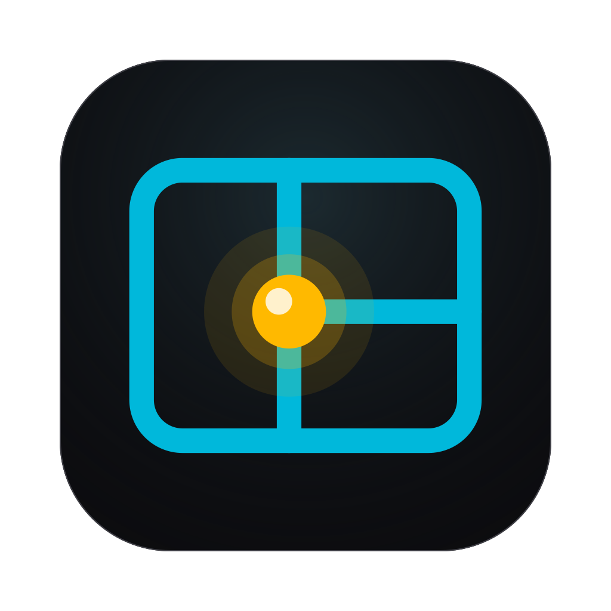
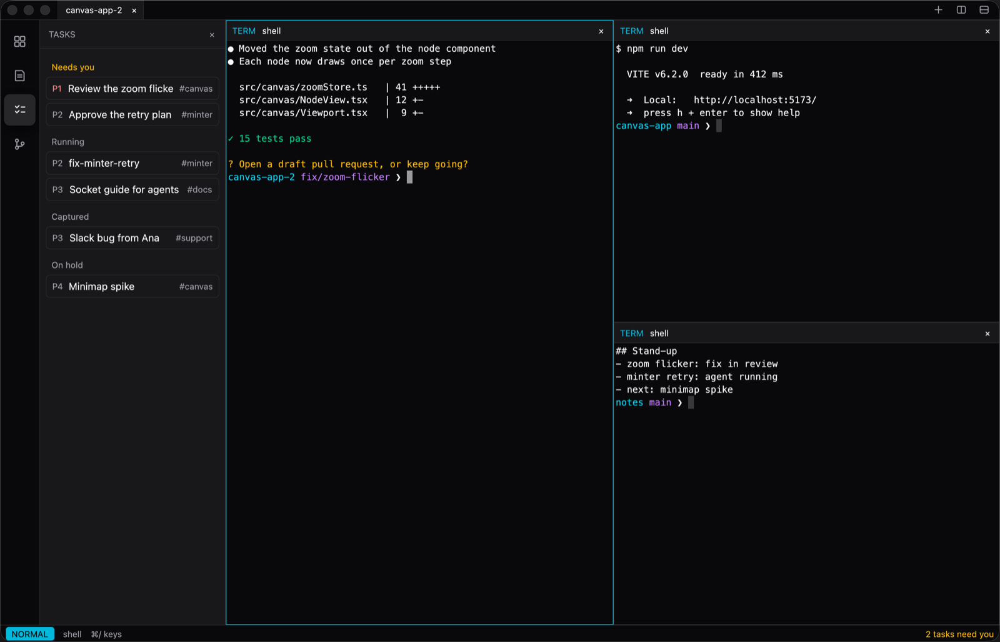
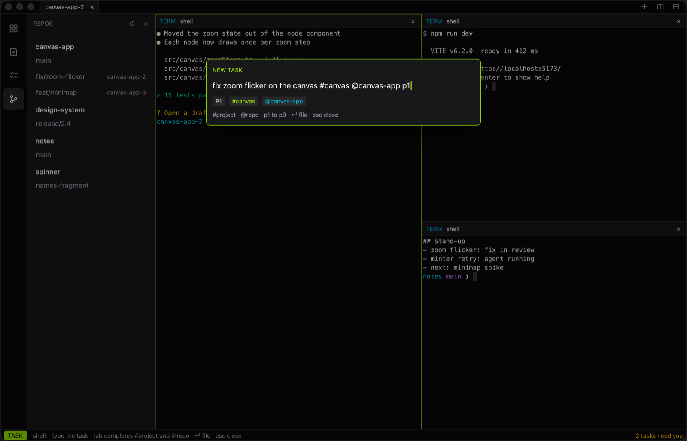

# ottospace



**AI-Native Command Center for your Agents and Apps**

ottospace puts your terminals and your Mac apps in one tiled workspace. Your agents work in the
same workspace and tell you when they need you.



Site: <https://bryan-uipath.github.io/ottospace/>

## All your apps, not just the terminal

Keep a shell next to the browser it serves and the chat where the bug was reported. ottospace
tiles terminals and your real Mac app windows side by side, in tabs and splits. Click an app and
use it as you always do.

## Stay organized and on top of your tasks

The inbox puts what needs you first, then what is running and what you saved for later. Press ⌘N
and say a task in one line, with a `#project`, a `>repo` and an `@agent`: ↵ starts its agent in a
drawer beside your workspace, and you see it work at once. Your repositories and their worktrees
are one click away.



## Agents are always ready to help

Your agents work in the workspace you see. An agent can open a pane, run a command and check its
own result, and flag a task when it needs you. It can read what an app pane shows; it does not
operate your apps.

Agents do this with the built-in `ottospace ctl` command:

```sh
ottospace ctl '{"cmd":"split","axis":"down"}'
ottospace ctl '{"cmd":"task_set_state","id":1,"state":"needs_you"}'
```

## Install

macOS 14 or later, on Apple silicon:

```sh
curl -fsSL https://raw.githubusercontent.com/bryan-uipath/ottospace/main/install.sh | sh
```

This installs two commands into `~/.local/bin`, with no `sudo`: `ottospace` (the latest build of
`main`; there is no tagged release yet) and `osi`, its installer.

```sh
osi update      # install the newer build, if there is one
osi rollback    # put the previous build back
osi uninstall   # remove ottospace and osi; settings and tasks are kept
```

Before you run it, know this:

- You trust this repository and GitHub, as with any `curl | sh`. Downloads are checked against a
  SHA-256, which catches a damaged download, not a compromised release.
- Builds are signed ad hoc and are not notarized.

Other builds, the app bundle, and what the checksum does and does not cover:
[docs/install.md](docs/install.md).

## Setup

Run `ottospace` from a terminal. It uses that terminal's permissions, so grant the terminal two,
once, in System Settings > Privacy & Security:

- **Accessibility**, to move app windows. ottospace exits at start without it.
- **Screen & System Audio Recording**, to show app windows in panes. macOS asks for it at launch.

A window opens on your repositories. Press ⌘D to split with a new terminal, and ⌘/ to see every key.

Click an app pane and the app has the keyboard. The return key gives it back to ottospace from
any app. It is F18, which most keyboards lack, so map Caps Lock to it:
[the return key](docs/reference.md#the-return-key).

## Learn more

- [The site](https://bryan-uipath.github.io/ottospace/): the tour, and a quickstart.
- [Cheat sheet](docs/cheat-sheet.md): one page for daily use.
- [Reference](docs/reference.md): every key, terminals and app panes, settings, `ottospace ctl`,
  how app windows are hosted, the roadmap.
- [Install and update](docs/install.md): `osi`, other builds, the app bundle.
- [Development](docs/development.md): build from source, tests, crates, CI, releasing.
- [Agent guide](crates/ottospace/skill/guide.md): what `ottospace skill` prints for coding
  agents. [AGENTS.md](AGENTS.md) holds the rules for working on this repository.
- [Design notes](docs/reference.md#design-docs): the plan and the research behind it.

## Status

Early software, macOS only, built in the open. What works today and what is designed but not
built: [the status tables and roadmap](docs/reference.md#roadmap-designed-not-built).

## License

[MIT](LICENSE).
