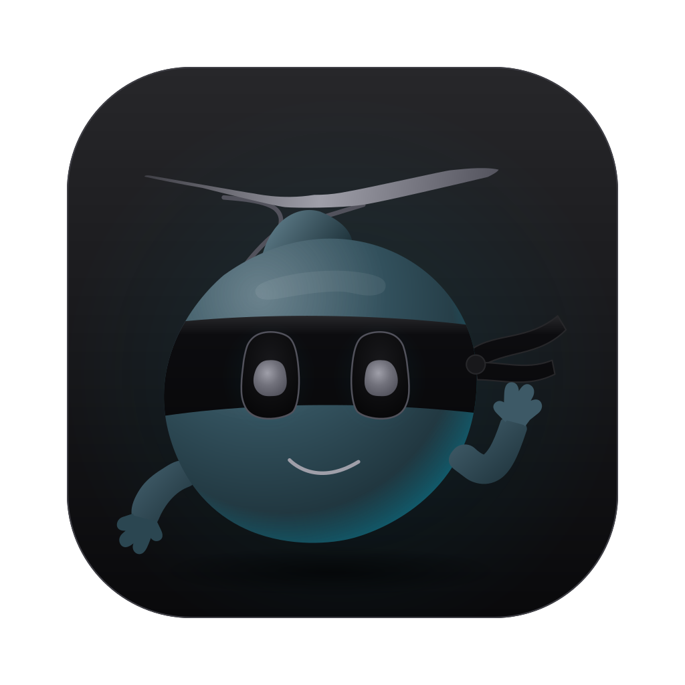

# ottospace



ottospace is a macOS workspace that tiles terminals and real app windows in one window. It is for
people who run several coding agents and want them, and the apps around them, in one place.
Agents and tests can drive it over a local control socket. Rust + [GPUI](https://gpui.rs).

## What it does

| Capability | State |
|---|---|
| Split panes mixing terminals and real app windows | Works today |
| Key bindings and a status bar showing `NORMAL` / `APP` mode | Works today |
| Control socket and `ottospace ctl` for agents and tests | Works today |
| Other key modes: insert, visual, sneak | Designed |
| Tasks: each owns a workspace (tabs, then splits) with a brief pane and automatic cleanup | Designed |
| "Pop next": open the next task by priority | Designed |
| Quick capture (⌘⌘): turn something on screen into a task and dispatch it to an agent | Designed |
| Focus blocks: hide Slack, with an agent that can break through | Designed |
| Tabs, each with its own split tree | Works today |
| Pane picker: choose a terminal or a running app for a new pane or tab | Works today |
| Icon rail with a secondary bar; Apps lists running apps | Works today |
| Fast app switcher; Workbook, Tasks and Repos sections | Designed |
| TypeScript scripting, with contextual quick actions in an action deck (Zoom meeting layout, spin for stand-up) | Designed |
| Hide private panes while screen sharing | Designed |
| Session restore | Designed |

## Status

Early prototype, macOS only. Today you can split a window into panes, run your shell in a pane,
host another app's window in a pane, move focus by keyboard, and drive all of it over the control
socket. Tasks, session restore and the rest of the design are not built: see the
[plan](docs/ai/1-initial-brainstorm/plan.md).

## Quick start

Requirements:

- macOS 14 or later.
- A Rust toolchain (edition 2024).
- Accessibility permission for the terminal that launches ottospace: System Settings > Privacy &
  Security > Accessibility. The app exits at start without it.
- Screen Recording permission for the same terminal: System Settings > Privacy & Security > Screen
  & System Audio Recording. macOS asks for it at launch, when ottospace lists running apps.

Build and run:

```sh
git clone https://github.com/bryan-uipath/ottospace
cd ottospace
cargo run -p ottospace
```

A window opens. Press ⌘D to open a terminal pane.

### Build the app

```sh
scripts/bundle.sh
open target/release/bundle/ottospace.app
```

This builds a release binary and wraps it as `ottospace.app` with the icon, so it has a Dock icon
and its own identity.

- Permissions attach to the app, not the terminal: macOS asks for Accessibility and Screen
  Recording for ottospace itself.
- The signature is ad hoc, so each rebuild is a new identity to macOS and you may have to grant
  both again. A stable identity needs a signing certificate, which the script does not set up.

`scripts/icon.sh` regenerates the icon from the SVG. It needs Google Chrome.

## Using it

| Key | Action |
|---|---|
| ⌘D | Split right, new terminal |
| ⌘⇧D | Split down, new terminal |
| ⌘E | Pick what goes in a new pane: a terminal or a running app |
| ⌘W | Close the focused pane |
| ⌘⌥←/→/↑/↓ or ⌘⌥H/L/K/J | Focus the pane in that direction |
| ⌘] / ⌘[ | Focus the next / previous pane |
| ⌘⌃F | Zoom the window to fill the screen; again to restore |
| ⌘/ | Show every key |
| F18 | From any app: take the keyboard back and bring ottospace forward |
| ⌘T | New tab: pick what opens in it |
| ⌘1 … ⌘9 | Select a tab |
| ⌘⇧] / ⌘⇧[ or ⌃Tab / ⌃⇧Tab | Next / previous tab |
| ⌘⇧W | Close the tab and its panes |

Other keys go to the focused terminal. ⌃ sends control codes, ⌥ is Meta.

A terminal pane runs your shell on a PTY. The pane closes when the shell exits.

To put an app window in a pane, open Apps on the left rail and click the app. It fills the focused pane if that is
empty, otherwise it splits right. Shift-click splits down. New windows of a hosted app get their
own pane. Original window frames are saved to disk and restored on quit or after a crash.

Click an app pane to give it the keyboard (`APP` mode). ottospace shortcuts do not fire in that
mode. Press the return key, or click ottospace itself (rail, top bar, another pane), to return.

The return key works while any app is frontmost. It is F18 by default; set `OTTOSPACE_RETURN_KEY`
to another of `f13`-`f20`. If another program already holds the key, ottospace logs that and runs
without a return key. Most keyboards have no F18, so map Caps Lock to it (lasts until restart):

```sh
hidutil property --set '{"UserKeyMapping":[{"HIDKeyboardModifierMappingSrc":0x700000039,"HIDKeyboardModifierMappingDst":0x70000006D}]}'
```

After this, Caps Lock no longer toggles capitals anywhere. The command replaces any key mapping
you already have. To undo it: `hidutil property --set '{"UserKeyMapping":[]}'`.

## Driving it from outside

ottospace listens on a Unix socket so tests and agents can inspect and drive it. The socket is mode
0600, at `$OTTOSPACE_SOCKET` or `$TMPDIR/ottospace.sock`. Send one JSON request per line. The reply
is one JSON line: the full state (model, mode, pane bounds, terminal grids) or
`{"ok":false,"error":"..."}`. `ottospace ctl` sends one request, prints the reply, and exits non-zero
if the request was refused. `cargo run` does not put `ottospace` on your `PATH`: use the built binary.

```sh
alias ottospace=./target/debug/ottospace
ottospace ctl '{"cmd":"split","axis":"down"}'
ottospace ctl '{"cmd":"type","text":"ls\r"}'
ottospace ctl '{"cmd":"open_app","name":"Safari"}'
ottospace ctl '{"cmd":"section","section":"apps"}'
ottospace ctl '{"cmd":"state"}'
```

Commands: `state`, `split`, `type`, `close`, `focus`, `focus_dir`, `open_app`, `enter`, `leave`,
`section`, `quit`. Fields are in `Request` in [`crates/ottospace/src/control.rs`](crates/ottospace/src/control.rs).
Unknown commands and fields are refused.

## Development

```sh
cargo test   # core unit tests. No window.
cargo e2e    # launches the app and drives it over the socket.
cargo e2e-apps   # hosts real windows of the canary test app; needs both permissions.
```

Terminal panes run your login shell. Set `OTTOSPACE_SHELL` to run another program instead (the
tests use `/bin/sh`). `cargo install` also installs the test app; use `--bin ottospace` to skip it.

`cargo e2e` is an alias in `.cargo/config.toml`. Each test opens a window on a private socket. It
sets `OTTOSPACE_E2E`, which turns window hosting off, so tests never touch your real windows.

| Path | Role |
|---|---|
| `crates/ottospace-core` | State and rules: `Model::update(Action) -> Vec<Effect>`. Split tree, key encoding. No I/O |
| `crates/ottospace-mac` | macOS calls: AX window control, SCK lookup, display geometry, HID clicks, crash recovery |
| `crates/ottospace` | The app: GPUI views, terminal, control socket, `ctl` client. Turns input into `Action`s, carries out `Effect`s |
| `crates/probe` | CLI that measures whether a parked window keeps rendering |
| `harness/` | Local input test page (`python3 -m http.server 8765 -d harness`) |
| `docs/` | Design notes |

Architecture rules and the test loops are in [AGENTS.md](AGENTS.md).

## How app windows are hosted

macOS cannot reparent another process's window, so ottospace fakes embedding with the Accessibility
(AX) API and ScreenCaptureKit (SCK). An inactive app window is parked off-screen with one pixel on
a display, and its pane shows an SCK stream of it. Clicking the pane moves the real window over it
and replays the click, so input is native. `crates/probe` measures whether a parked window keeps
rendering. Measurements and risks: [docs/ai/hosting-windows.md](docs/ai/hosting-windows.md).

## Design docs

[`docs/ai/1-initial-brainstorm/`](docs/ai/1-initial-brainstorm/) holds the AI-derived notes for the
first brainstorm:

- [plan.md](docs/ai/1-initial-brainstorm/plan.md): model, phases and decisions.
- [quick-capture.md](docs/ai/1-initial-brainstorm/quick-capture.md): quick capture and task lifecycle.
- [screen-share-privacy.md](docs/ai/1-initial-brainstorm/screen-share-privacy.md): hiding panes from screen sharing.
- [scripting.md](docs/ai/1-initial-brainstorm/scripting.md): scripting in TypeScript.
- [zoom-meeting.md](docs/ai/1-initial-brainstorm/zoom-meeting.md): Zoom meeting layout and participants.
- `background/`: icon and mockup images.

[`docs/ai/backlog.md`](docs/ai/backlog.md) is an older backlog. `docs/ideas/` holds the owner's own
notes.
