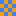

# Markdown fixture

Everything the viewer and the conversation draw, once each. Made-up content only. A change to
the renderer is judged against this file: `scripts/shot --compare <base> viewer-markdown`.

## Emphasis and inline

Plain text, *emphasis*, **strong**, ***both***, ~~struck~~, and `inline code` in a sentence.
A line with a hard break at its end  
and the line after it. Escaped \*stars\* stay stars. A very long word:
pneumonoultramicroscopicsilicovolcanoconiosis-and-then-some-more-to-overflow-a-narrow-pane.

### A third-level heading

#### A fourth-level heading

##### A fifth-level heading

###### A sixth-level heading

## Lists

- One
- Two
  - Two, nested
    - Two, nested twice
    - Another at the third level
  - Back to the second level
- Three

1. First
2. Second
   1. Second, first
   2. Second, second
      1. Third level, numbered
3. Third

A list of its own:

7. A list that starts at seven
8. and goes on

Tasks:

- [x] Write the fixture
- [ ] Draw checkboxes as boxes
- [ ] Nested:
  - [x] done inside
  - [ ] not done inside

## Tables

| Left | Centre | Right |
|:-----|:------:|------:|
| a | b | c |
| longer cell text | `code` | 1,234.50 |
| **bold** | *em* | [link](https://example.com/table) |

| Column one | Column two | Column three | Column four | Column five | Column six | Column seven | Column eight |
|---|---|---|---|---|---|---|---|
| a wide table whose cells hold more than a narrow pane can show at once | 2 | 3 | 4 | 5 | 6 | 7 | 8 |

## Code blocks

```rust
/// Adds one.
fn bump(n: u32) -> u32 {
    n.saturating_add(1) // never wraps
}
```

```ts
export function greet(name: string): string {
  return `hello, ${name}`;
}
```

```js
const items = [1, 2, 3].map((n) => n * 2);
console.log(items);
```

```python
def mean(values: list[float]) -> float:
    """The average, or 0 for none."""
    return sum(values) / len(values) if values else 0.0
```

```sh
#!/bin/sh
set -eu
for f in *.md; do wc -l "$f"; done
```

```json
{ "name": "fixture", "version": 2, "tags": ["a", "b"], "nested": { "ok": true, "none": null } }
```

```yaml
name: fixture
on: [push]
jobs:
  test:
    runs-on: macos-latest
```

```toml
[package]
name = "fixture"
edition = "2024"
```

```go
package main

import "fmt"

func main() { fmt.Println("hello") }
```

```swift
struct Point { var x = 0.0, y = 0.0 }
let origin = Point()
```

```sql
SELECT id, title FROM tasks WHERE state = 'open' ORDER BY id DESC LIMIT 10;
```

```diff
--- a/notes.txt
+++ b/notes.txt
@@ -1,3 +1,3 @@
 unchanged
-removed line
+added line
```

    An indented code block, four spaces in.

```
A fence with no language, and a line long enough to need a horizontal scroll in any pane narrower than a hundred and fifty characters across.
```

## Quotes and callouts

> A quote, one paragraph.
>
> > A quote inside a quote.

> [!NOTE]
> A callout: useful information the reader should know.

> [!WARNING]
> A warning callout, with `code` and **strong** text.

## Footnotes

A sentence with a footnote.[^one] And another.[^long]

[^one]: The first footnote.
[^long]: A footnote with more words in it, to see how it wraps at the foot of the page.

## Links

An [inline link](https://example.com/docs), a [relative link](checker.png), a
[link to a heading](#tables), and an autolink <https://example.com/auto>. A bare address:
https://example.com/bare. A long link:
[the full address shown](https://example.com/a/very/long/path/that/goes/on/and/on/for/quite/a/while/index.html?query=one&other=two#fragment).

A Slack archive link: https://example.slack.com/archives/C0123ABCD/p1700000000000100 and a
mention <@U0123> as Slack writes it.

## Images

A local image beside this file:



A web image, never fetched:


## Rules

Above a rule.

---

Below it; another kind:

***

## HTML-looking text

<details><summary>Click to open</summary>

Text inside details.

</details>

A <kbd>Ctrl</kbd>+<kbd>C</kbd> and an <b>inline tag</b>; a comment <!-- hidden? --> here.

<div align="center">a centred block</div>

Ampersands &amp; entities &lt;tag&gt; and &copy; 2026.

## The end

Last line of the fixture.
